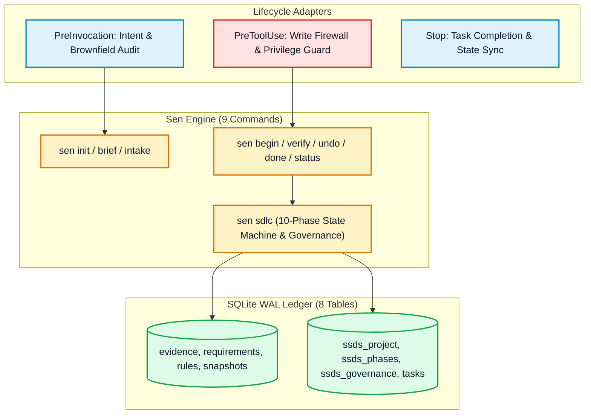

<div align="center">

# 🪷 Sen-VN

**Deterministic AI Software Engineering, SEN-STD-SDLC-001 (`SSDS v1.0.0`) Quality Governance & Creative Workspace Referee (`sen`)**

[](https://github.com/developerfs0110/Sen-VN/releases)
[](https://golang.org)
[](LICENSE)
[](internal/ssds/SSDS_CHANGELOG.md)

---

### 📑 NAVIGATION TABS

| 🇻🇳 [**README (Tiếng Việt)**](README.md) | 🚀 [**Setup Guide**](docs/installation/README.md) | 🇬🇧 [**English Documentation**](README.en.md) | 📋 [**Release Notes**](docs/releases/v1.2.0.md) |
|:---:|:---:|:---:|:---:|

---

</div>

## 1. The Context: Why AI Coding Fails at Scale

The emergence of AI coding assistants (Claude Code, Cursor, Windsurf, Codex, Gemini CLI) has dramatically accelerated initial code writing. However, in real-world software engineering, raw speed without discipline leads to critical systemic failures:

- **Task Amnesia & Scope Creep:** AI agents quickly lose track of earlier requirements, hallucinate missing contexts, and silently drop edge cases as conversations grow long.
- **Premature Coding ("Cowboy Coding"):** Agents rush into generating production code immediately upon reading a prompt, completely skipping requirements analysis, architecture design, and data modeling.
- **Fake Test Passes & Metric Gaming:** Agents frequently fabricate synthetic `"PASS"` claims or invent tautological test assertions that never actually run in a real subprocess.
- **Zero Blast Radius Failures:** Modifying one file silently breaks unstated assumptions in sibling modules, or pollutes umbrella workspaces containing multiple unrelated repositories.
- **Token Bleed & Infinite Repair Loops:** When encountering syntax or runtime errors, agents spin in endless trial-and-error edits, burning through hundreds of thousands of tokens without making structural progress.

---

## 2. The Purpose of Sen: Discipline Meets Autonomy

**Sen** is not just another code generation tool. **Sen is an AI-Native Software Engineering & Quality Governance Referee**.

Sen acts as an incorruptible supervisor that enforces established software engineering disciplines on top of any AI assistant. It bridges the gap between raw LLM intelligence and enterprise-grade reliability by embedding the **SEN SOFTWARE DEVELOPMENT STANDARD (`SEN-STD-SDLC-001 v1.0.0`, 7 Parts / 28 Sections)** directly into an unforgeable local state machine.

With Sen, an AI assistant is no longer an erratic solo coder, but an accountable, role-based engineering team governed by physical write firewalls, cryptographic evidence chains, and strict human approval checkpoints.

---

## 3. Why Choose Sen? (Best-of-the-Best Highlights)

- **Zero-Prompt Automatic SDLC Activation:** Automatically detects software development requests in bilingual Vietnamese and English, runs Brownfield Repository Audits (§2.3), bootstraps adaptive workflows (`WF_MICRO | WF_STANDARD | WF_CRITICAL`), and declares phase objectives without requiring human prompts.
- **Pre-Execution Write Firewall:** Physically locks production source files and manifests during planning and design phases (`P0..P3`). Code cannot be touched until requirements and architecture are locked.
- **27 Engineering Roles & Honest Review:** Enforces separation of duties (`author_role != reviewer_role`). Unverified AI claims are automatically downgraded to `SELF_REVIEW` with transparent disclosure.
- **6-Link Traceability Matrix:** Cryptographically validates full traceability across `Requirement -> Component -> Task -> File -> Evidence -> Release` in `docs/traceability-matrix.md`.
- **Cryptographic Evidence Chain:** Every test execution and build verification is recorded in a tamper-evident SHA-256 hash-chained SQLite WAL ledger (`.sen/state.db`).
- **One-Shot Change Impact Analysis (CIA):** Approved architecture baselines are locked by SHA-256 hash. Any subsequent structural modification strictly requires a 10-dimension `CIA-*` impact evaluation (§17).
- **Multi-Project Isolation:** Target-path nearest-project resolution and umbrella workspace guards prevent sibling repositories from contaminating one another.
- **Independent Standard Versioning (Part II):** Each project pins its own `applied_ssds_version` signed in `.sen/config.json`. Upgrading the global standard never silently breaks existing projects.

---

## 4. Modular Installation Hub

```text
┌─────────────────────────────────────────────────────────────────────────────┐
│                       MODULAR INSTALLATION GUIDES                           │
├─────────────────────────────────────────────────────────────────────────────┤
│  • Windows (PowerShell)        ──>  docs/installation/windows.md            │
│  • Linux & macOS (POSIX)       ──>  docs/installation/linux-macos.md        │
│  • Google Antigravity IDE      ──>  docs/installation/antigravity.md        │
│  • VSCode, Cursor & Claude     ──>  docs/installation/vscode.md             │
│  • Troubleshooting Guide       ──>  docs/installation/troubleshoot.md        │
└─────────────────────────────────────────────────────────────────────────────┘
```

### Quick 1-Liner Installation:

**Windows PowerShell (No Admin / UAC Required):**
```powershell
irm https://raw.githubusercontent.com/developerfs0110/Sen-VN/main/scripts/install-sen.ps1 | iex
```

**macOS & Linux (POSIX Shell, No Root Required):**
```bash
curl -fsSL https://raw.githubusercontent.com/developerfs0110/Sen-VN/main/scripts/install-sen.sh | sh
```

**Native Google Antigravity IDE Plugin:**
```bash
git clone https://github.com/developerfs0110/Sen-VN.git .agents/plugins/sen-vn
```

For complete options and detailed environment setup, visit [**Setup Hub (docs/installation/README.md)**](docs/installation/README.md).

---

## 5. Architectural Overview

Sen-VN is built with pure Go (zero external dependencies, zero CGO, zero Docker requirement) backed by an **8-table SQLite WAL ledger** and a streamlined **9-command CLI surface**:



---

## 6. License & Community

- **License:** Open-source under the [MIT License](LICENSE).
- **Official Repository:** [https://github.com/developerfs0110/Sen-VN](https://github.com/developerfs0110/Sen-VN)
- **Standard Reference:** SEN-STD-SDLC-001 v1.0.0 (`internal/ssds/versions/v1.0.0/standard.md`).
- **All Releases:** [docs/releases/README.md](docs/releases/README.md).

---

## ☕ 7. Support the Author & Contribute (Donate)

**Sen-VN** is an open-source project designed and maintained independently to elevate software discipline and engineering rigor in the age of AI.

If Sen-VN helps you save time, protect your codebase, and bring peace of mind to pair programming with AI, your support is warmly appreciated and directly funds continuous development:

<div align="center">

### 👤 Author & Lead Architect: **Mr Bòn Bon** (anh Gấu)
📧 **Email:** `tunbh.study@gmail.com`  
📱 **Phone / Zalo:** `(+84) 793.166.866` • `(+84) 96.158.1163`  

🏦 **Bank Donation Account (TPBank Vietnam):**
```text
Bank: TPBank (Tien Phong Commercial Joint Stock Bank)
Account Number: 61.222.666.888
Account Holder: BUI HAI TUN
```

*Thank you for your generous support and partnership!* 🪷

</div>

