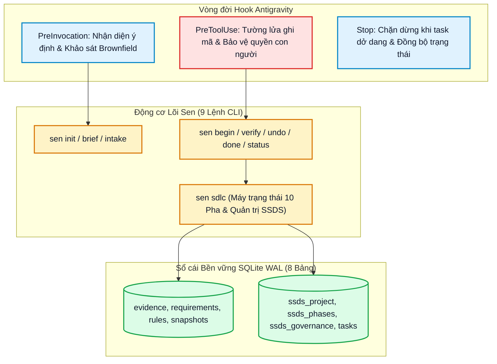

<div align="center">

# 🪷 Sen-VN

**Hệ Điều Hành Kỹ Nghệ Phần Mềm Cho AI • Cưỡng Chế Quy Chuẩn SEN-STD-SDLC-001 (`SSDS v1.0.0`) • Trọng Tài Kiểm Chứng Xác Định**

[](https://github.com/developerfs0110/Sen-VN/releases)
[](https://golang.org)
[](LICENSE)
[](internal/ssds/SSDS_CHANGELOG.md)

---

### 📑 ĐIỀU HƯỚNG / NAVIGATION TABS

| 🇻🇳 [**README (Tiếng Việt)**](README.md) | 🚀 [**Cài Đặt (Setup)**](docs/installation/README.md) | 🇬🇧 [**English Documentation**](README.en.md) | 📋 [**Release Notes**](docs/releases/v1.2.0.md) |
|:---:|:---:|:---:|:---:|

---

</div>

## 1. Bối cảnh: Tại sao AI Lập trình Thất bại ở Dự án Lớn?

Sự bùng nổ của các trợ lý AI lập trình (Claude Code, Cursor, Windsurf, Codex, Gemini CLI...) đã mang lại tốc độ viết mã vượt bậc. Tuy nhiên, trong thực tế kỹ nghệ phần mềm chuyên nghiệp, tốc độ mà thiếu đi tính kỷ luật sẽ dẫn đến những hậu quả nghiêm trọng:

- **Bệnh quên task & nói trước quên sau:** Càng trao đổi lâu, AI càng dễ mất ngữ cảnh yêu cầu ban đầu, tự bịa ra thông tin (hallucination) và bỏ quên các trường hợp biên quan trọng.
- **Thói quen "nhảy cóc" vào gõ code bừa (Cowboy Coding):** Vừa nhận đề bài, AI lập tức lao vào viết mã nguồn ngay mà bỏ qua hoàn toàn các bước phân tích yêu cầu, thiết kế kiến trúc, mô hình dữ liệu và kiểm thử chấp nhận.
- **Bằng chứng giả mạo & Gian lận chỉ số:** AI rất hay tự báo cáo `"PASS"` cho những bài test chưa từng thực sự được chạy, hoặc tự viết các câu assert hiển nhiên đúng (tautological tests) để qua mặt người dùng.
- **Phá vỡ bán kính an toàn (Zero Blast Radius):** Sửa một tính năng nhỏ nhưng âm thầm làm gãy đổ các module liên quan, hoặc làm ô nhiễm chéo các dự án độc lập nằm chung trong một Workspace mẹ.
- **Đốt token & Vòng lặp sửa lỗi vô tận:** Khi gặp lỗi biên dịch hay runtime, AI thường rơi vào vòng xoáy đoán mò và sửa đi sửa lại hàng chục lần, tiêu tốn hàng trăm ngàn token vô ích mà không giải quyết được gốc rễ.

---

## 2. Mục đích của Sen: Kỷ Luật Tạo Nên Sự Đột Phá

**Sen** không phải là thêm một công cụ sinh mã thông thường. **Sen là Khung Điều Phối & Trọng Tài Kiểm Chứng Chất Lượng Phần Mềm AI-Native (AI-Native Software Engineering & Quality Governance Referee)**.

Sen đóng vai trò là "người bảo hộ" và "nhạc trưởng" nghiêm khắc, chuyển hóa năng lực của các mô hình AI thành một đội ngũ kỹ sư có tổ chức và có trách nhiệm giải trình. Bằng cách biên dịch toàn bộ **QUY CHUẨN PHÁT TRIỂN PHẦN MỀM SEN (`SEN-STD-SDLC-001 v1.0.0`, 7 Phần / 28 Điều khoản)** thành máy trạng thái vật lý, Sen đảm bảo AI phải tuân thủ nghiêm ngặt các quy tắc kỹ thuật mà không thể đi đường tắt.

Với Sen, AI không còn là một tay thợ code chạy rông, mà là một tổ chức kỹ sư hoàn chỉnh được kiểm soát bởi tường lửa ghi mã vật lý, chuỗi băm chứng cứ mật mã và các cổng phê duyệt độc lập của con người.

---

## 3. Tại sao nên chọn Sen? (Best-of-the-Best Highlights)

- **Tự động nhận diện & Kích hoạt 0 câu nhắc thừa:** Tự động phát hiện yêu cầu phát triển phần mềm song ngữ Việt–Anh, tự quét khảo sát dự án sẵn có (Brownfield Repo Audit §2.3), phân loại quy trình thích ứng (`WF_MICRO | WF_STANDARD | WF_CRITICAL`) và tuyên bố mục tiêu pha mà không cần nhắc lại.
- **Tường lửa ghi mã tiền thi hành:** Khóa cứng quyền ghi mã nguồn và manifest trong các pha chuẩn bị (`P0..P3`). AI bắt buộc phải hoàn thành và được duyệt tài liệu yêu cầu, kiến trúc trước khi được phép đụng vào code.
- **27 Vai trò Kỹ sư & Phản biện Trung thực:** Bắt buộc tách biệt vai trò (`author_role != reviewer_role`). Các đánh giá AI không có kiểm chứng độc lập sẽ tự động bị hạ cấp xuống `SELF_REVIEW` kèm cảnh báo minh bạch.
- **Ma trận truy xuất nguồn gốc 6 liên kết:** Đối soát chặt chẽ chuỗi `Requirement -> Component -> Task -> File -> Evidence -> Release` trong `docs/traceability-matrix.md`.
- **Chuỗi băm bằng chứng kiểm thử mật mã:** Mọi kết quả thực thi kiểm thử và build thật được lưu trữ bất biến vào sổ cái SQLite WAL 8 bảng có băm SHA-256 (`.sen/state.db`).
- **Phân tích tác động thay đổi 1 lần dùng (CIA):** Tài liệu kiến trúc sau khi được duyệt sẽ bị khóa băm. Mọi thay đổi cấu trúc sau đó bắt buộc phải lập hồ sơ phân tích tác động 10 chiều (`CIA-*`) trước khi mở khóa.
- **Cách ly tuyệt đối đa dự án:** Tự động định vị dự án con gần nhất và cơ chế bảo vệ thư mục mẹ giúp ngăn chặn 100% tình trạng nhiễm chéo tài liệu và trạng thái giữa các dự án con.
- **Quản trị phiên bản tiêu chuẩn độc lập (Phần II):** Mỗi dự án được ghim phiên bản tiêu chuẩn riêng (`applied_ssds_version`) có chữ ký điện tử. Nâng cấp chuẩn toàn cục không bao giờ làm phá vỡ các dự án cũ đang vận hành.

---

## 4. Menu Cài Đặt Nhanh & Điều Hướng

```text
┌─────────────────────────────────────────────────────────────────────────────┐
│                       DANH MỤC HƯỚNG DẪN CÀI ĐẶT                            │
├─────────────────────────────────────────────────────────────────────────────┤
│  • Hướng dẫn Windows (PowerShell)      ──>  docs/installation/windows.md    │
│  • Hướng dẫn Linux & macOS (POSIX)     ──>  docs/installation/linux-macos.md│
│  • Tích hợp Google Antigravity IDE     ──>  docs/installation/antigravity.md│
│  • Dùng với VSCode, Cursor & Claude    ──>  docs/installation/vscode.md     │
│  • Sổ tay Xử lý Sự cố (Troubleshooting)──> docs/installation/troubleshoot.md│
└─────────────────────────────────────────────────────────────────────────────┘
```

### Cài đặt nhanh 1 lệnh duy nhất:

**Windows PowerShell (Không cần quyền Admin / UAC):**
```powershell
irm https://raw.githubusercontent.com/developerfs0110/Sen-VN/main/scripts/install-sen.ps1 | iex
```

**macOS & Linux (POSIX Shell, Không cần root):**
```bash
curl -fsSL https://raw.githubusercontent.com/developerfs0110/Sen-VN/main/scripts/install-sen.sh | sh
```

**Plugin Antigravity Bản địa:**
```bash
git clone https://github.com/developerfs0110/Sen-VN.git .agents/plugins/sen-vn
```

Xem đầy đủ các tùy chọn tại [**Setup Hub (docs/installation/README.md)**](docs/installation/README.md).

---

## 5. Tổng Quan Kiến Trúc Kỹ Thuật

Sen-VN được viết bằng Go thuần túy (không CGO, không phụ thuộc thư viện ngoài, không cần Docker), vận hành trên sổ cái **SQLite WAL 8 bảng** và bề mặt **9 lệnh CLI chuẩn mực**:



---

## 6. Giấy Phép & Đóng Góp

- **Giấy phép:** Mã nguồn mở theo giấy phép [MIT License](LICENSE).
- **Kho lưu trữ chính thức:** [https://github.com/developerfs0110/Sen-VN](https://github.com/developerfs0110/Sen-VN)
- **Văn bản quy chuẩn gốc:** SEN-STD-SDLC-001 v1.0.0 (`internal/ssds/versions/v1.0.0/standard.md`).
- **Danh mục phiên bản phát hành:** [docs/releases/README.md](docs/releases/README.md).

---

## ☕ 7. Ủng Hộ Tác Giả & Đóng Góp Phát Triển (Donate)

**Sen-VN** là dự án mã nguồn mở được kiến trúc và phát triển hoàn toàn độc lập với khát vọng nâng tầm tính kỷ luật, chất lượng và vị thế của cộng đồng lập trình viên Việt Nam trong kỷ nguyên AI.

Nếu Sen-VN giúp ích cho công việc của bạn, bảo vệ tài nguyên dự án và mang lại sự yên tâm khi làm việc cùng AI, mọi sự ủng hộ của bạn đều là nguồn động lực quý báu để tác giả tiếp tục nâng cấp và duy trì dự án:

<div align="center">

### 👤 Tác giả & Chủ nhiệm Kiến trúc: **Mr Bòn Bon** (anh Gấu)
📧 **Email:** `tunbh.study@gmail.com`  
📱 **Hotline / Zalo:** `(+84) 793.166.866` • `(+84) 96.158.1163`  

🏦 **Tài khoản Ngân hàng Nhận Ủng Hộ (TPBank):**
```text
Ngân hàng: TPBank (Ngân hàng TMCP Tiên Phong)
Số tài khoản: 61.222.666.888
Chủ tài khoản: BUI HAI TUN
```

*Trân trọng cảm ơn sự đồng hành và tin tưởng của anh em và cộng đồng phát triển phần mềm!* 🪷

</div>
